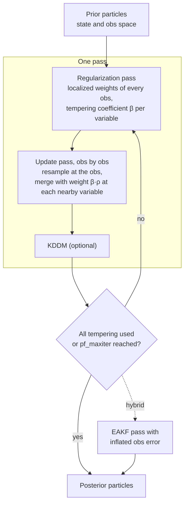

# Localized particle filter (LPF) for DART

This branch adds a **localized particle filter** to DART's `filter`, selected
with `filter_kind = 9`. Unlike DART's ensemble Kalman filters, the LPF makes no
Gaussian assumption about the prior or the likelihood. It weights and resamples
the ensemble members (particles) as a particle filter does, and it uses
localization so that this works with realistic ensemble sizes in large models.

The method is described in Poterjoy (2016), Poterjoy and Anderson (2016),
Poterjoy et al. (2019) and Poterjoy (2021). Contact: Jon Poterjoy
(poterjoy@umd.edu).

## Documentation

| Page | What it covers |
|---|---|
| [How the LPF works](docs/lpf/algorithm.md) | Localized weights, tempering and passes, resampling and merging, KDDM, binning, the hybrid PF-EAKF step |
| [Namelist reference](docs/lpf/namelist.md) | Every LPF option in `&assim_tools_nml`, with defaults and interactions |
| [Tuning guide](docs/lpf/tuning.md) | Which settings matter, with results from Lorenz-96 and bgrid tests |
| [Troubleshooting](docs/lpf/troubleshooting.md) | Build quirks, slow runs, warnings, filter divergence |

## When to use it

The LPF is worth trying when the Gaussian assumptions behind the EAKF break
down: strongly nonlinear observation operators, non-Gaussian (skewed,
bounded, multimodal) priors, or long forecast intervals.

In near-Gaussian settings, an EAKF with adaptive inflation is cheaper and,
at modest ensemble sizes, more accurate. In bgrid tests the LPF approaches the
EAKF as the ensemble grows (see the [tuning guide](docs/lpf/tuning.md)).

## Quick start

**1. Build with the LPF.** The LPF version of the assimilation module is
`assimilation_code/modules/assimilation/assim_tools_mod.pf.f90`. DART's build
skips that file, so copy it over the compiled module first:

```bash
cd assimilation_code/modules/assimilation
cp assim_tools_mod.pf.f90 assim_tools_mod.f90
cd ../../../models/<your_model>/work
./quickbuild.sh
```

(`git checkout assim_tools_mod.f90` restores the stock module.)

**2. Select the LPF** in `input.nml`:

```fortran
&assim_tools_nml
   filter_kind = 9,
   cutoff      = 0.5,      ! localization half-width (radians on the sphere)
   frac_neff   = 0.8,      ! target effective ensemble size / Ne
   pf_maxiter  = 3,        ! passes per cycle (1 = single pass)
   pf_kddm     = 1,        ! kernel density distribution mapping after each pass
   pf_bin_rho  = 0.95,     ! bin nearby obs for the merge (faster, usually better)
   /

&filter_nml
   inf_flavor = 0, 0,      ! no inflation with the LPF
   /
```

**3. Run `filter` as usual.** The log reports `Number of PF iterations` each
cycle. Set `pf_diag = .true.` to also print the tempering diagnostics.

## How it works, in one picture



The details are on the [algorithm page](docs/lpf/algorithm.md).

## References

- Poterjoy, J., 2016: A localized particle filter for high-dimensional
  nonlinear systems. *Mon. Wea. Rev.*, **144**, 59–76.
- Poterjoy, J., and J. L. Anderson, 2016: Efficient assimilation of simulated
  observations in a high-dimensional geophysical system using a localized
  particle filter. *Mon. Wea. Rev.*, **144**, 2007–2020.
- Poterjoy, J., L. Wicker, and M. Buehner, 2019: Progress toward the
  application of a localized particle filter for numerical weather
  prediction. *Mon. Wea. Rev.*, **147**, 1107–1126.
- Poterjoy, J., 2021: Implications of multivariate non-Gaussian data
  assimilation for multiscale weather prediction. *Mon. Wea. Rev.* (hybrid
  PF-EAKF).
