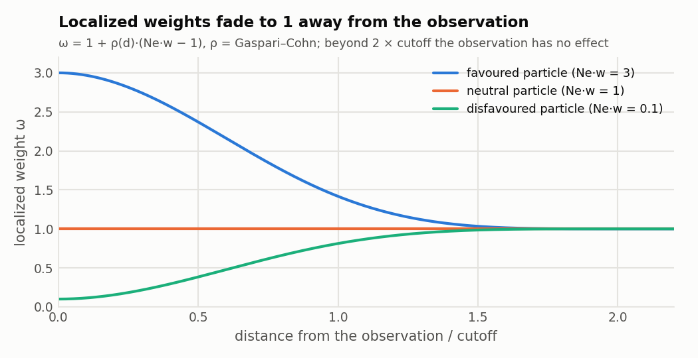
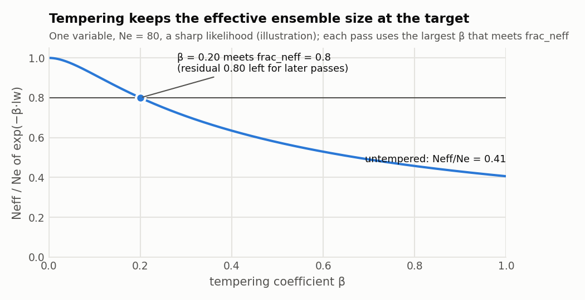

# How the LPF works

[← LPF overview](../../README_LPF.md) · [Namelist](namelist.md) · [Tuning](tuning.md) · [Troubleshooting](troubleshooting.md)

The ensemble members are treated as $N_e$ particles. As in DART's other
filters, observations are processed one at a time. But instead of a Kalman
increment, each observation **reweights** the particles, **resamples** them
where the observation is, and **merges** the resampled particles with the
current ones elsewhere, in proportion to the localization.

Every state variable and every observation prior carries its own particle
weights. These accumulate the localized influence of all observations
processed so far.

All of this is in
`assimilation_code/modules/assimilation/assim_tools_mod.pf.f90`
(`filter_assim` and the `pf_*` routines).

**Contents**
- [1. Localized weights](#1-localized-weights)
- [2. Tempering and passes](#2-tempering-and-passes)
- [3. The update pass](#3-the-update-pass)
- [4. KDDM](#4-kddm)
- [5. Binning nearby observations](#5-binning-nearby-observations)
- [6. Hybrid PF-EAKF](#6-hybrid-pf-eakf)
- [7. Random numbers](#7-random-numbers)

## 1. Localized weights

For an observation $y$ with error variance $R$ and prior obs-space particles
$h_i$, the likelihood weights are

$$
w_i = \frac{\exp\left(-\frac{(y - h_i)^2}{2R}\right)}{\sum_j \exp\left(-\frac{(y - h_j)^2}{2R}\right)}.
$$

A variable at distance $d$ from the observation receives the **localized
weight**

$$
\omega_i = 1 + \rho(d)~\bigl(N_e w_i - 1\bigr),
$$

where $\rho$ is the Gaspari–Cohn function with half-width `cutoff`. At the
observation ($\rho = 1$) this is the full weight; beyond twice the cutoff
($\rho = 0$) it is uniform. Each variable keeps the running sum of
$-\log \omega_i$ over the observations processed so far: `lw` for state
variables and `lhw` for observation priors.

<picture>
  <source media="(prefers-color-scheme: dark)" srcset="figures/fig_localized_weights_dark.png">
  
</picture>

**Weight floor.** If the smallest normalized weight $w_i$ is below
$10^{-15}/N_e$, the likelihood is tempered (an effective inflation of $R$,
found by bisection in `pf_regularization_minw`) until the smallest weight
reaches the floor. This guards against very sharp likelihoods and is
hard-coded.

## 2. Tempering and passes

Applying all observations at once can collapse the weights onto a few
particles. The LPF therefore **tempers** each variable's accumulated weights:

$$
\tilde w_i \propto \exp\left(-\beta~ \ell_i\right), \qquad \ell_i = \sum_{\text{obs}} -\log \omega_i ,
$$

with the largest $\beta \in (0, 1]$ for which the effective ensemble size

$$
N_\text{eff}(\beta) = \frac{1}{\sum_i \tilde w_i^2}
$$

reaches `frac_neff` × $N_e$. Each state variable and each
observation prior gets its own $\beta$, found in `pf_regularization` by a
safeguarded Newton iteration. Two cases override that:
- $\beta = 1$ when the untempered weights already meet the target.
- $\beta$ is capped by the variable's remaining residual (below), so that the
  $\beta$ values of all passes sum to at most 1.

<picture>
  <source media="(prefers-color-scheme: dark)" srcset="figures/fig_tempering_dark.png">
  
</picture>

The untempered remainder $1 - \beta$ is assimilated in later **passes**. One
cycle runs:

1. **Regularization pass.** Compute every observation's weights and every
   variable's $\ell_i$; then each variable's $\beta$. Each variable tracks the
   residual $1 - \sum \beta$ still to be assimilated.
2. **Update pass.** Assimilate the observations sequentially with the
   tempered weights ([section 3](#3-the-update-pass)), then optional KDDM
   ([section 4](#4-kddm)).
3. **Repeat** from the updated particles until every observation's residual
   is used up, or `pf_maxiter` passes have run.

With `pf_maxiter = 1` the filter makes a single pass: $\beta$ still prevents
weight collapse, but any remaining residual is dropped. The log line
`Number of PF iterations` reports the number of passes used.

## 3. The update pass

For each observation, in sequence order:

1. **Resample at the observation.** The task that owns the observation draws
   $N_e$ indices by systematic resampling (`pf_sample`) from the
   observation's own tempered, localized weights. Particles that survive keep
   their index, and the duplicates fill the vacated slots in random order.
   Resampling, and the merges that follow it, are skipped only when the
   weights are exactly uniform. An earlier rule also skipped them when the
   weights were nearly uniform ($N_\text{eff} \gt  0.98~N_e$), so that nearby
   variables only accumulated the observation's weights, with no merge; set
   [`pf_resample_neff`](namelist.md#pf_resample_neff) to 0.98 to restore it.
2. **Weight each nearby variable.** Every state variable and observation prior
   within the localization radius adds this observation's $-\log\omega_i$ to
   its running sum. It forms its posterior weights $\exp(-\beta \ell_i)$ and
   the weighted posterior mean $\bar x$ and variance from its prior particles.
3. **Merge.** The resampled particles $x^s$ (the variable's prior values at the
   drawn indices) are blended with its current particles $x$, using the
   tempered localization coefficient:

   ```math
   x_i^{\mathrm{blend}} = \bar{x} + \beta\rho\,\left(x_i^{s} - \bar{x}\right) + \left(1 - \beta\rho\right)\left(x_i - \bar{x}\right)
   ```

   The blend is then adjusted to the weighted posterior by one of two methods
   (`pf_merge`):
   - **Moment matching** (`pf_merge = 0`, default; `pf_update`). A
     Cornish-Fisher transform fits up to four moments (`pf_nmoments`):
     $z \mapsto z + \tfrac{\Delta S}{6}(z^2-1) + \tfrac{\Delta K}{24}(z^3-3z) - \tfrac{\Delta S^2}{36}(2z^3-5z)$.
     The skewness and kurtosis differences $\Delta S$, $\Delta K$ are shrunk
     by their sampling reliability and clipped to keep the map close to
     monotone. The result is rescaled to the exact posterior mean and
     variance. The weighted kurtosis uses a bias-corrected estimator
     (`pf_kurt`).
   - **Rank quantile mapping** (`pf_merge = 1`; `pf_update_qm`). Only the ranks
     of the blend are kept. The particle of rank $k$ gets the weighted
     posterior quantile at $(k - \tfrac12)/N_e$, with short kernel tails
     beyond the particle range, then is shifted and scaled to the posterior
     mean and variance (`pf_qm_moments`).
4. **Observation priors are updated the same way**, including observations
   already assimilated, because later passes use them.

So a variable at the observation ($\beta\rho \to 1$) is replaced by the
resampled particles. A distant one ($\rho \to 0$) keeps its own particles, and
the merge then only adjusts their moments to the localized posterior.

## 4. KDDM

With `pf_kddm > 0`, after each update pass every state variable and
observation prior whose posterior particles lie outside the range of its
prior particles is remapped by **kernel density distribution mapping**
(`pf_kddm_update`). Each current particle's quantile among the current
particles (kernel-smoothed) is mapped to the same quantile of the
kernel-smoothed posterior CDF built from the prior particles and their
weights. The bandwidth is `bw_factor` × $\sqrt{2}~\sigma~N_e^{-1/5}$,
with $\sigma$ the spread of the current particles.
With `pf_kddm = 2` (bounded), particles stay within the range of the prior
particles. With `pf_kddm = 1` they can extrapolate linearly beyond it.

## 5. Binning nearby observations

With `pf_bin_rho > 0`, nearby observations are grouped into bins at the start
of each cycle (`pf_make_bins`). In observation-sequence order, an observation
joins the first bin whose centroid has localization coefficient at least
`pf_bin_rho` with it; otherwise it starts a new bin. Centroids are updated as
observations join.

Within a bin, every observation still contributes its own localized weights,
so the targets and $\beta$ do not change. But **resampling and merging happen
once**, after the bin's last observation, localized about the bin centroid.
The resampling indices come from the bin's most central member. This cuts the
number of merges, which otherwise accumulate heavy tails, and it saves time.

## 6. Hybrid PF-EAKF

With `pf_enkf_hybrid = .true.`, the PF passes stop when each observation has
used 1 − `min_residual` of its tempering. A final EAKF pass then
assimilates every observation with its error variance inflated by
1/`min_residual`, and relaxation to prior spread (`pf_kf_rtps_coeff`)
is applied after it (Poterjoy 2021).

## 7. Random numbers

The resampling random sequence is initialized once per run. The seed combines
the time of the first observation, the MPI task and `pf_seed`, so cycles and
passes do not reuse random numbers. Change `pf_seed` to run independent
realizations of an experiment.
