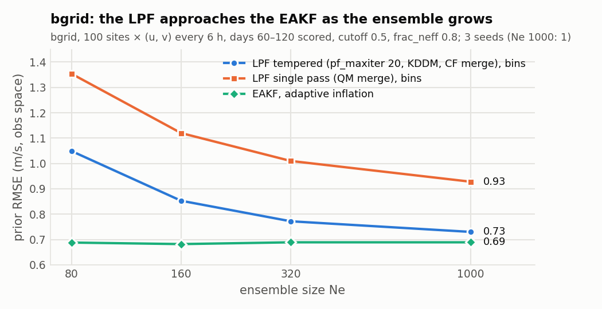
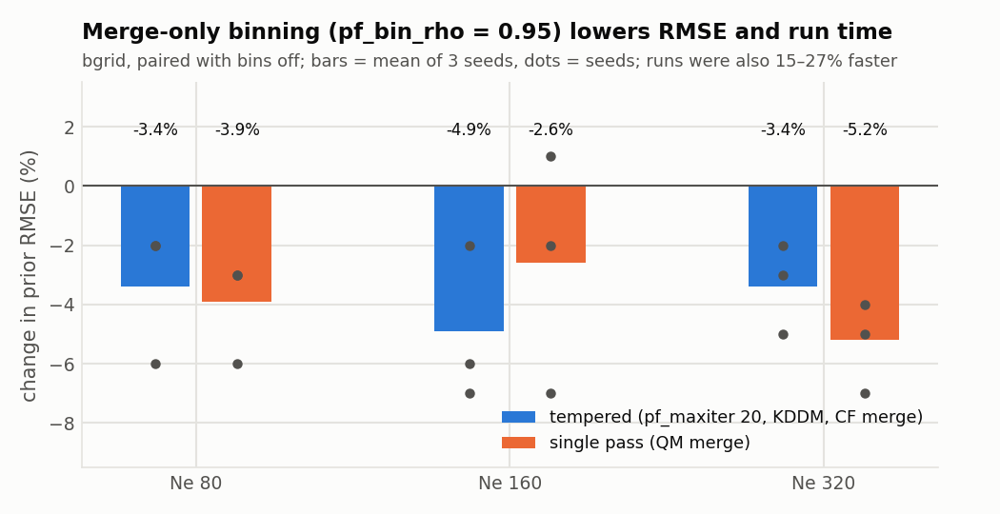

# Tuning the LPF

[← LPF overview](../../README_LPF.md) · [Algorithm](algorithm.md) · [Namelist](namelist.md) · [Troubleshooting](troubleshooting.md)

**Contents**
- [Starting point](#starting-point)
- [frac_neff and the number of passes](#frac_neff-and-the-number-of-passes)
- [Ensemble size](#ensemble-size)
- [Localization cutoff](#localization-cutoff)
- [Binning](#binning)
- [KDDM and the merge](#kddm-and-the-merge)
- [Cost](#cost)

The results below come from two test systems:
- **Lorenz-96**, run in DART.
- **bgrid**, DART's dry dynamical core: 60 × 30 × 5 grid; 100 sites
  observing u and v at level 3 every 6 h, with error variance 3; 120-day
  runs scored over days 60–120.

Unless stated otherwise, the bgrid runs use the code in this branch with
$N_e = 80$, `cutoff = 0.5` and `frac_neff = 0.8`. Your system will differ, so
use them as a guide to which knobs matter, not as settings to copy.

## Starting point

```fortran
&assim_tools_nml
   filter_kind = 9,
   cutoff      = 0.5,     ! tune; see below
   frac_neff   = 0.8,     ! lower (0.1-0.4) for long forecast intervals
   pf_maxiter  = 3,       ! bgrid used 4-5 passes at frac_neff 0.8; capping at 3 cost little
   pf_kddm     = 1,
   pf_bin_rho  = 0.95,
   /
```

Tune in this order: **ensemble size, `frac_neff` with `pf_maxiter`, then
`cutoff`.** Binning and KDDM are usually worth leaving on.

## frac_neff and the number of passes

`frac_neff` sets how much of the likelihood each pass may use. Through that
it sets the **number of passes**, and in Lorenz-96 tests the number of passes
was what mattered:

- Accuracy is best with about **2–3 tempering steps** per cycle, in both
  linear and nonlinear (squared) observation networks.
- **One untempered step diverged.**
- **Many steps degrade the filter:** error and spread grow with the step count.
- Runs with different `frac_neff` lined up on one curve when plotted against
  their mean number of passes.

A practical rule is to set `frac_neff` to roughly **2–5 times the untempered
$N_\text{eff}/N_e$**, about twice when that value is large and more when it
is small. That untempered value depends mostly on how far the
prior has spread, i.e. the forecast interval, more than on how nonlinear the
observation operator is:

| Forecast interval (Lorenz-96) | Untempered $N_\text{eff}/N_e$ | Good `frac_neff` |
|---|---|---|
| 1 h (one model step) | about 0.3–0.6 | 0.6–0.8 |
| 12 h | about 0.03–0.1 | 0.1–0.2 |

To measure the untempered value in your own system, set `pf_diag = .true.`
and read `mean_ess1/Ne` on the `PFDIAG` lines. If `Number of PF iterations`
always equals `pf_maxiter`, the tempering is not finishing: lower `frac_neff`
or raise `pf_maxiter`.

Values of `frac_neff` at 0.9 and above give many small steps. In bgrid
(earlier build, $N_e = 80$) they made the ensemble over-dispersive (spread
1.7–7.9 against RMSE 1.2–3.3). In sparse networks they can diverge.

## Ensemble size

The LPF's sampling error falls with $N_e$ more slowly than the EAKF's. In
bgrid, which is close to Gaussian, the tempered LPF's excess error over the
EAKF roughly halves with each doubling of $N_e$ up to 320. It is within 6% of
the EAKF at $N_e = 1000$.

<picture>
  <source media="(prefers-color-scheme: dark)" srcset="figures/fig_bgrid_ne_dark.png">
  
</picture>

| $N_e$ | LPF tempered | LPF single pass | EAKF (adaptive inflation) |
|---|---|---|---|
| 80 | 1.049 | 1.354 | 0.688 |
| 160 | 0.853 | 1.120 | 0.682 |
| 320 | 0.772 | 1.010 | 0.689 |
| 1000 | 0.730 | 0.928 | 0.689 |

*Prior RMSE in obs space (m/s). LPF tempered: `pf_maxiter = 20`, KDDM,
Cornish-Fisher merge. LPF single pass: quantile-mapping merge. Both LPF
variants with `pf_bin_rho = 0.95`. Means of 3 seeds; Ne = 1000 is 1 seed for each LPF variant.*

- **The tempered configuration beats the single pass at every ensemble size.** The single pass is also
  over-dispersive at small $N_e$ (spread 2.1 against RMSE 1.35 at $N_e = 80$).
  This improves with ensemble size (spread 1.4 at 320, 1.2 against RMSE 0.93 at 1000).
- **The LPF's advantage is in non-Gaussian problems.** This bgrid setup is
  close to Gaussian, which is where the EAKF does best.

## Localization cutoff

`cutoff` interacts with $N_e$. More particles can support a wider radius:

| $N_e$ | `cutoff` | Tempered LPF prior RMSE |
|---|---|---|
| 80 | 0.3 / **0.5** / 0.8 | 1.19 / **1.08** / 1.58 |
| 1000 | 0.5 / **0.7** / 1.0 | 0.730 / **0.669** / 0.724 |

*bgrid. The Ne = 80 row comes from an earlier build, before the binning and
merge changes, so compare values across that row only. At Ne = 1000 and
cutoff 0.7, the LPF beats the EAKF at cutoff 0.5 (0.689), but not the EAKF at
cutoff 1.0 (0.564).*

Tune `cutoff` and `frac_neff` together: a wider cutoff gives each variable
more observations and sharper weights, so it needs more tempering.

## Binning

Merge-only binning (`pf_bin_rho = 0.95`) groups nearby observations, so
resampling and merging happen once per bin. In every bgrid configuration
tested it lowered the prior RMSE by 3–5% and cut run time by 15–27%:

<picture>
  <source media="(prefers-color-scheme: dark)" srcset="figures/fig_bgrid_bins_dark.png">
  
</picture>

It also helped or was neutral in every Lorenz-96 configuration tested. The
reason it helps: each merge adds a little kurtosis, so many merges at nearly
the same location build up heavy tails in the particles. In tests with the
MATLAB version of the LPF, these tails grew with the number of merges for
co-located observations. Binning removes most of the repeated merges.

## KDDM and the merge

- **KDDM** (`pf_kddm = 1`) corrects the distribution shape after each pass.
  In tests with the MATLAB version of the LPF, with tempering it lowered
  errors in 22 of 24 network × `frac_neff` cases and prevented the failures
  seen without it (sparse networks, co-located observations). Without
  tempering it was neutral. Its cost in DART is modest: under 10% of run time
  in profiles.
- **Merge.** The default moment-matching merge with four moments
  (`pf_nmoments = 4`) had the fewest failures in hard cases among the merges
  tested. Its skewness and kurtosis corrections are shrunk by their sampling
  reliability. With aggressive single-pass settings (`frac_neff` about 0.2)
  it prefers `frac_neff` ≥ 0.4. The quantile-mapping merge (`pf_merge = 1`)
  is an alternative for single-pass runs.

## Cost

Cost grows with the number of passes, and each pass is a regularization pass
plus an update pass. Later passes are cheaper, because close lists and
localization factors are cached (`pf_cache_close`). In bgrid:

| Run | Mean passes per cycle | Run time | Relative to EAKF |
|---|---|---|---|
| EAKF, $N_e = 80$ | — | 212 s | 1 |
| LPF single pass, $N_e = 80$ | 1 | 267 s | 1.3 |
| LPF tempered, $N_e = 80$ | 5.2 | 402 s | 1.9 |
| LPF tempered, $N_e = 1000$ (EAKF 2165 s) | 4.4 | 7499 s | 3.5 |

*Both LPF runs with binning; 40 MPI tasks.*

*The run times above predate the exchange speed-ups described next.*

**Exchanges between MPI tasks.** Observation weights, QC and verticals, and
resampling indices are exchanged in blocks of observations instead of one
broadcast per observation, and finished state variables and observations are
skipped in later passes. These changes are exact: results are byte-identical.
In bgrid tests with 80 members and tempering, the assimilation time of a
3-day test fell from 508 s to 153 s. On a network of 3000 soundings (about
48,000 obs per cycle), a 120-day run fell from 16,851 s to 5,144 s of wall
time. The block size is set by
[`pf_gather_mb`](namelist.md#pf_gather_mb); the default suits most runs. To see
where time goes, set [`pf_profile`](namelist.md#pf_profile).

Most of the remaining time goes to `exp` and `log` in the weight loops, so:
- **Compile with `-O3` and an architecture flag** (e.g.
  `-march=skylake-avx512`) so that vectorized math functions are used. This
  roughly halved run times, with identical results to rounding.
- **Keep `pf_cache_close = .true.`** (the default) and **use binning.**
- **Reduce passes:** use a lower `frac_neff` or `pf_maxiter`.
